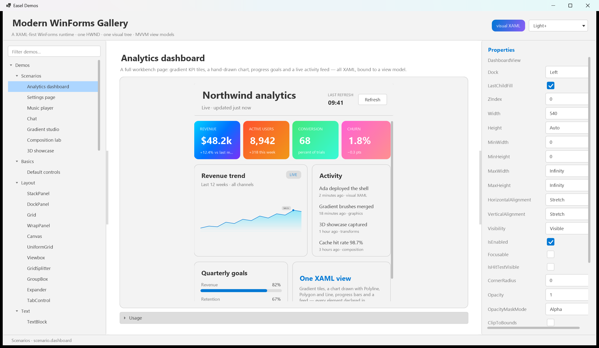

<div align="center">


# Easel

**A XAML-first UI runtime for WinForms.**

[](https://www.nuget.org/packages/WinForms.Easel)
[](LICENSE.txt)
[](skills/)



<sub><code>Examples/XamlGallery</code> · Light+ · one HWND, a visual tree, XAML views and view models.</sub>

</div>

## One HWND, one visual tree

Easel puts a WPF/Avalonia-shaped control library over a single `VisualHost`. Every control derives
from `VisualElement`, not from a WinForms control; the only window is the host, and the whole tree is
painted in one pass. `native:` elements (`NativeElement`) place WinForms controls in the same layout pass and can
host visual content; `NativeControlHost` is the code-behind equivalent.

```csharp
ApplicationConfiguration.Initialize();

var host = new VisualHost { Dock = DockStyle.Fill };
host.Root = new DashboardView();     // a partial class compiled from visual XAML
Controls.Add(host);
```

That gives you dependency properties, measure/arrange, styles, templates, triggers, bindings, commands,
resource dictionaries and a retained visual layer without giving up the WinForms application model.

## XAML in, controls out

A view is a normal `x:Class` file: the markup compiles into an `InitializeComponent()`, and
`[XamlProperty]` becomes a dependency property.

```xml
<StackPanel
    xmlns="http://schemas.microsoft.com/winfx/2006/xaml/presentation"
    xmlns:x="http://schemas.microsoft.com/winfx/2006/xaml"
    x:Class="MyApp.Views.SettingsView"
    Spacing="12">

  <StackPanel.Resources>
    <Style x:Key="Title" TargetType="TextBlock">
      <Style.Setters>
        <Setter Property="FontSize" Value="19" />
        <Setter Property="FontWeight" Value="SemiBold" />
        <Setter Property="Foreground" Value="{StaticResource Text}" />
      </Style.Setters>
    </Style>
  </StackPanel.Resources>

  <TextBlock Style="{StaticResource Title}" Text="Workspace settings" />
  <TextBox Text="{Binding DisplayName, Mode=TwoWay}" />
  <Button Text="Save" Command="{Binding SaveCommand}" />
</StackPanel>
```

```csharp
public sealed partial class SettingsView : StackPanel
{
    public SettingsView()
    {
        DataContext = new SettingsViewModel();
        InitializeComponent();
    }
}
```

### Native controls

A `clr-namespace:System.Windows.Forms` prefix declares a native control directly. The compiler wraps it in
`NativeElement<Foo>`; you never write the host:

```xml
<StackPanel
    xmlns="http://schemas.microsoft.com/winfx/2006/xaml/presentation"
    Spacing="12">

  <native:GroupBox x:Name="nativeGroup" Margin="12" Width="280" Text="Native group">
    <StackPanel Spacing="6">
      <TextBlock Text="Visual content inside a native container" />
      <native:Button Text="Native button" Click="OnNativeClick" />
    </StackPanel>
  </native:GroupBox>
</StackPanel>
```

`Margin`, `Width`/`Height`, `Min`/`Max`, alignment, `Visibility`, `DataContext` and attached properties write the
wrapper and take part in the normal measure/arrange pass. `Text`, `Padding`, `BackColor`, `AutoSize` and events
write the native control; a native property can also bind through a proxy property (`Mode=TwoWay` reports back
through `INotifyPropertyChanged`, `XxxChanged` or an idle fallback; native focus raises the wrapper's logical focus events). `CornerRadius` rounds the live window, popups cut
rectangular holes in it, and `IsSnapshot="True"` paints the control as a bitmap in the visual pass so `Opacity`
and `Transform` apply. In a Form an almost invisible input proxy keeps mouse, keyboard and IME working: opacity
and translation are exact, scale re-lays the control out at the scaled size, and rotation keeps the transformed
polygon interactive. The wrapper measures with `GetPreferredSize`, places the HWND in physical pixels, and
re-measures when the native preferred size changes. A native element hosts one visual content root; that content
is painted by a nested surface over `DisplayRectangle`. The island is still an HWND: it cannot be transformed,
alpha-blended or clipped to a shape by the outer tree.

### Compiled bindings

Bindings resolve through `TypeDescriptor` by default. Add `x:DataType` and opt in with `x:CompileBindings` to
compile data-context paths into direct property access:

```xml
<StackPanel x:DataType="vm:SettingsViewModel" x:CompileBindings="True">
  <TextBox Text="{Binding DisplayName, Mode=TwoWay}" />
</StackPanel>
```

The generator emits a typed reader per binding; `INotifyPropertyChanged`, converters, `StringFormat`, fallback
values and validation still apply. `Source`, `ElementName`, `RelativeSource` and `TemplateBinding` stay runtime
bindings, and a `DataTemplate` sets its own item type with `x:DataType`.

## What is in the box

| Area | What you get |
| --- | --- |
| **Layout** | `StackPanel`, `DockPanel`, `Grid`, `WrapPanel`, `Canvas`, `UniformGrid`, `Viewbox`, `GridSplitter`, `GroupBox`, `Expander`, `TabControl` |
| **Text** | `TextBlock`, self-drawn `TextBox`, password/multiline editing, fully visual templated fields, `RichTextBox`, `Image` |
| **Data** | `DataGrid` (virtualized 2-D table with sortable headers and badge/progress cells), `ListBox`, `ComboBox`, `VirtualList`, `TreeView`, `Calendar`, `DatePicker`, `CollectionView`, native drag in/out with `DropZone` |
| **Input** | `Button`/`RepeatButton`, toggles, `Slider`, `ProgressBar`, focus and keyboard navigation |
| **Overlay** | `VisualPopup`, `VisualMenu`, `VisualContextMenu` in a surface overlay above the root tree |
| **Styling** | Styles, triggers, `ControlTemplate` + `ContentPresenter`, keyed resources, `StaticResource` and `DynamicResource` |
| **Binding** | One-way/two-way/one-time paths, converters, validation, inherited `DataContext`, commands, compiled `x:DataType` paths |
| **Visuals** | Brushes, gradients, opacity/clip/effects, opacity masks, cached layers, exact-perspective 3D transforms |
| **Native** | `native:` elements (`NativeElement<T>`) in the same measure/arrange pass, visual content inside a native container, `NativeControlHost` for code-behind |
| **Theme** | Dark+/Light+ XAML dictionaries, high contrast, follow-system mode, custom `ResourceDictionary` themes |

## Themes are resource dictionaries

The built-in Dark+ and Light+ palettes and typography styles are WPF-style `<ResourceDictionary>` XAML
files in [`Src/Easel/Themes/`](Src/Easel/Themes/). `Theme.CreateDark()` / `CreateLight()` read those
resources, and `Theme.CreateResourceDictionary(mode)` returns a copy for an application.

```xml
<ResourceDictionary x:Class="Easel.Themes.DarkTheme" ...>
  <SolidColorBrush x:Key="Window" Color="#FF141414" />
  <SolidColorBrush x:Key="Accent" Color="#FF0078D4" />
  <x:Double x:Key="CornerRadius">4</x:Double>
  <x:Int32 x:Key="ControlHeight">28</x:Int32>
  <Style x:Key="Heading" TargetType="TextBlock">…</Style>
</ResourceDictionary>
```

- `ThemeMode.System` follows the Windows app theme and listens for later changes through
  `SystemEvents.UserPreferenceChanged`; Windows high contrast resolves to the high-contrast palette.
- Applications can author their own dictionary and apply it with
  `ThemePalette.FromResourceDictionary(...)`; the gallery's High contrast option is exactly that demo.
- Standalone dictionary roots, keyed styles/templates, scalar resources and `MergedDictionaries`
  (compiled dictionary types or inline dictionaries) are supported. File-URI `Source="..."` is not:
  Easel has no runtime XAML loader.

## Brushes, composition and 3D

```xml
<Border.Background>
  <LinearGradientBrush StartPoint="0,0" EndPoint="1,1">
    <GradientStop Color="#FF00D2FF" Offset="0" />
    <GradientStop Color="#FF7B2FF7" Offset="1" />
  </LinearGradientBrush>
</Border.Background>

<Border.Transform3D>
  <Rotate3DTransform AngleX="16" AngleY="24" CenterX="120" CenterY="90" Depth="700" />
</Border.Transform3D>
```

- Gradients work as brushes and as text foregrounds: `DrawString` receives the native gradient brush.
- `Visual`/`ContainerVisual`/`ShapeVisual`/`TextVisual` compose through `VisualPresenter`; group
  opacity, clip, drop shadow, `CacheAsBitmap` and `OpacityMask` (Alpha or Luminance) all compose one
  layer before painting.
- `Rotate3DTransform` / `Scale3DTransform` / `Translate3DTransform` / `MatrixTransform3D` /
  `Transform3DGroup` project a 2D subtree through a perspective-correct inverse homography.
  Hit testing and damage bounds use the same map, and `CacheAsBitmap` reuses the pre-warp layer.

## Data tables and native drag

`DataGrid` is a row-virtualized two-dimensional table. Columns are plain objects with a binding path, width,
alignment, sortability and a cell kind (`Text`, `Badge`, `Check`, `Progress`); zero-width columns share the room
left by the fixed ones, and the header edge resizes a column in place.

```xml
<DataGrid ItemsSource="{Binding Rows}" ShowRowNumbers="True" RowHeight="32">
  <DataGrid.Columns>
    <DataGridColumn Header="Project" BindingPath="Name" Width="0" MinWidth="140" />
    <DataGridColumn Header="Value" BindingPath="Value" Width="80" TextAlignment="Right" StringFormat="N0" />
    <DataGridColumn Header="Status" BindingPath="Status" Width="96" Kind="Badge" />
    <DataGridColumn Header="Progress" BindingPath="Progress" Width="104" Kind="Progress" StringFormat="0'%'" />
    <DataGridColumn Header="Live" BindingPath="Enabled" Width="50" Kind="Check" TextAlignment="Center" />
  </DataGrid.Columns>
</DataGrid>
```

Dragging is the native Windows OLE loop, not a private gesture. `AllowDrop` on any element routes
`DragEnter`/`DragOver`/`DragLeave`/`Drop` to the deepest target and bubbles through its ancestors; `DropZone`
is a ready surface for files, text and rows; `VisualDragDrop.StartDrag` starts a drag with text and
`FileDrop` formats. Two `DataGrid`s in one process exchange an `Easel.DataGrid.Rows` payload, so a move keeps
the same row object and removes it from the source collection.

## The living reference

`Examples/XamlGallery` is the catalogue and the contract: a three-pane workbench whose shell, every card
and the full scenario pages are XAML views with view models.

```bash
dotnet run --project Examples/XamlGallery/Demo/Demo.csproj
```

Useful switches:

```bash
dotnet run --project Examples/XamlGallery/Demo/Demo.csproj -- --smoke
dotnet run --project Examples/XamlGallery/Demo/Demo.csproj -- --entry scenario.dashboard
dotnet run --project Examples/XamlGallery/Demo/Demo.csproj -- --light
dotnet run --project Examples/XamlGallery/Demo/Demo.csproj -- --system
dotnet run --project Examples/XamlGallery/Demo/Demo.csproj -- --capture ./captures --all
```

[`Examples/XamlGallery/README.md`](Examples/XamlGallery/README.md) has the catalog table, capture
details and the per-feature notes.

## Packages

```powershell
dotnet add package WinForms.Easel
```

| Package | Targets |
| --- | --- |
| `WinForms.Easel` | `netframework4.6.1` · `net5.0-windows` · `netcoreapp3.0` · `net8.0-windows` |

The runtime and the gallery do not reference VeloxDev. The gallery carries its own minimal
`ObservableObject` / `RelayCommand` in `Examples/XamlGallery/Demo/Mvvm`; it also opts into WPF for the real
`MediaPlayer` / `MediaElement` audio and video pages. Animation is Easel's own engine. The Easel runtime
still has no WPF dependency.

## Build and test

```bash
dotnet build Easel.slnx -c Release
dotnet test Src/Test/Unit/Easel.Test/Easel.Test.csproj -c Release
dotnet run --project Examples/XamlGallery/Demo/Demo.csproj
```

### Gallery references

The gallery builds against the Easel source projects in this repository. Its MVVM helpers are local demo
code (`Demo.Mvvm`), so the demo has no package or source dependency on VeloxDev.

## Animation engine

Easel carries its own animation engine. Trigger actions, keyframe animations and `VisualTransition`
interpolate values, pace frames and hold the end value themselves; there is no backend to register and no
injection seam. Animations write at `BindingPriority.Animation` and, when they complete or are stopped, hold
the reached value at local precedence so a later local or style write can take over.

The engine interpolates numbers, geometry (`Point`, `Size`, `Rectangle`, `Padding`, `Thickness`), 2D/3D
transforms, `Color` and `Brush`. Brush and `Transform3D` interpolation is structural: gradient shapes and 3D
transform parameters are lerped rather than flattened. A property whose CLR type has no interpolation is
rejected with a clear `NotSupportedException` at the call site.

## Repository map

| Path | What it holds |
| --- | --- |
| [`Src/Easel/`](Src/Easel/) | The runtime: dependency properties, visual tree, controls, themes |
| [`Src/Easel/Themes/`](Src/Easel/Themes/) | Built-in Dark+/Light+ XAML resource dictionaries |
| [`Src/Test/Unit/Easel.Test/`](Src/Test/Unit/Easel.Test/) | Unit and render tests |
| [`Examples/XamlGallery/`](Examples/XamlGallery/) | The living catalogue and all scenario pages |
| [`skills/`](skills/) | The Easel WinForms-XAML UI guide |

## License

Released under the [MIT License](LICENSE.txt). © 2025 Axvser
