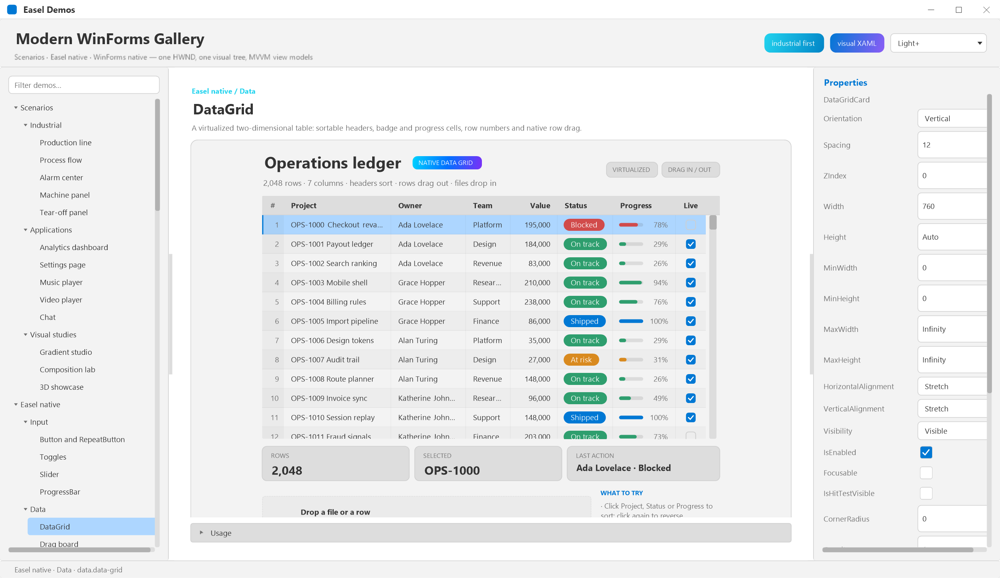
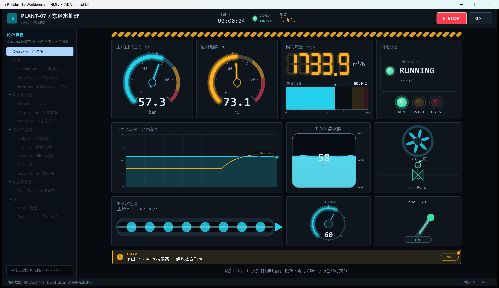

<div align="center">


# Easel

**A XAML-first UI runtime for WinForms.**

[](https://www.nuget.org/packages/WinForms.Easel)
[](LICENSE.txt)
[](skills/)


<sub><b>Gallery · Data</b> — one visual tree, a virtualized 2-D <code>DataGrid</code>, and a live view model.</sub>


<sub><b>Industrial Workbench</b> — a separate demo: fourteen live HMI controls on one visual surface.</sub>

</div>

## What it is

Easel puts a WPF/Avalonia-shaped control library over a single WinForms `VisualHost`. Every control
derives from `VisualElement`; the tree paints in one pass and the markup compiles ahead of time.

- **One surface.** `VisualHost` is the only top-level HWND. `native:` elements and `NativeControlHost`
  are the deliberate native islands inside the layout.
- **XAML-first.** `.xaml` views compile to `InitializeComponent`; `[XamlProperty]` becomes a dependency
  property. There is no runtime XAML loader.
- **Everything visual is a control.** Layout, text, data, overlays, styles, templates, triggers,
  resources and compiled `x:DataType` bindings.
- **Animation built in.** Trigger actions, keyframe animations and `VisualTransition`; nothing to register.
- **Themes as dictionaries.** Dark+ and Light+ XAML palettes, high contrast, follow-system and custom
  `ResourceDictionary` themes.
- **Data and visuals.** `DataGrid`, `VirtualizingListBox`, `TreeView`, `ComboBox`, calendar and date
  pickers; gradient brushes, opacity masks, effects, cached layers and perspective 3D.

## Quick start

```powershell
dotnet add package WinForms.Easel
```

```xml
<Window xmlns="http://schemas.microsoft.com/winfx/2006/xaml/presentation"
        xmlns:x="http://schemas.microsoft.com/winfx/2006/xaml"
        xmlns:local="clr-namespace:MyApp.Views"
        x:Class="MyApp.MainWindow" Title="My app" Width="1200" Height="800">
  <local:DashboardView />
</Window>
```

```csharp
using Easel.Visuals;

public partial class MainWindow : Window
{
    public MainWindow() => InitializeComponent();
}

Application.Run(new MainWindow());
```

`WinForms.Easel` targets `net45`, `net5.0-windows`, `netcoreapp3.0` and `net8.0-windows`; generated
code follows the project's language version.

## Examples

| Path | What it is |
| --- | --- |
| [`Examples/XamlGallery`](Examples/XamlGallery/) | The catalogue behind both screenshots: controls, scenario pages, themes and capture switches |
| [`Examples/IndustrialWorkbench`](Examples/IndustrialWorkbench/) | A control workbench with self-drawn HMI widgets |
| [`skills/`](skills/) | The WinForms XAML UI guide |

## Build and test

```bash
dotnet build Easel.slnx -c Release
dotnet test Src/Test/Unit/Easel.Test/Easel.Test.csproj -c Release
```

## License

Released under the [MIT License](LICENSE.txt). © 2025 Axvser
